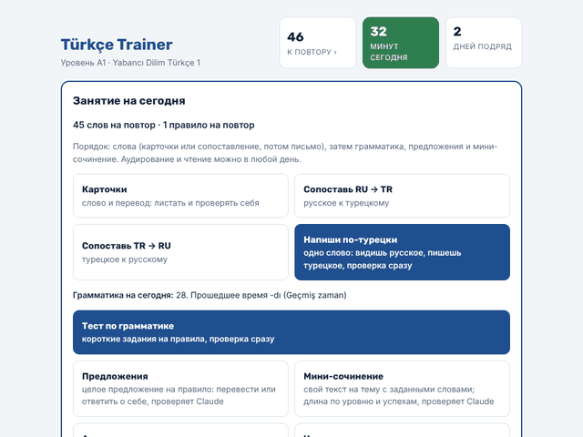
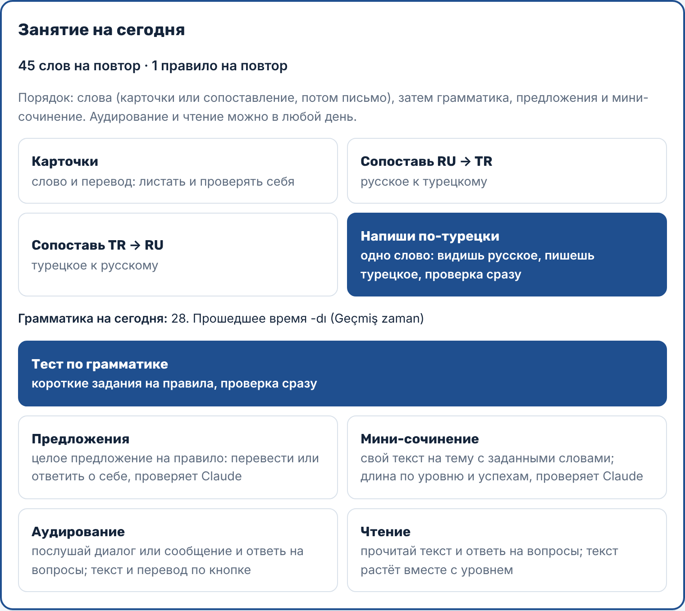
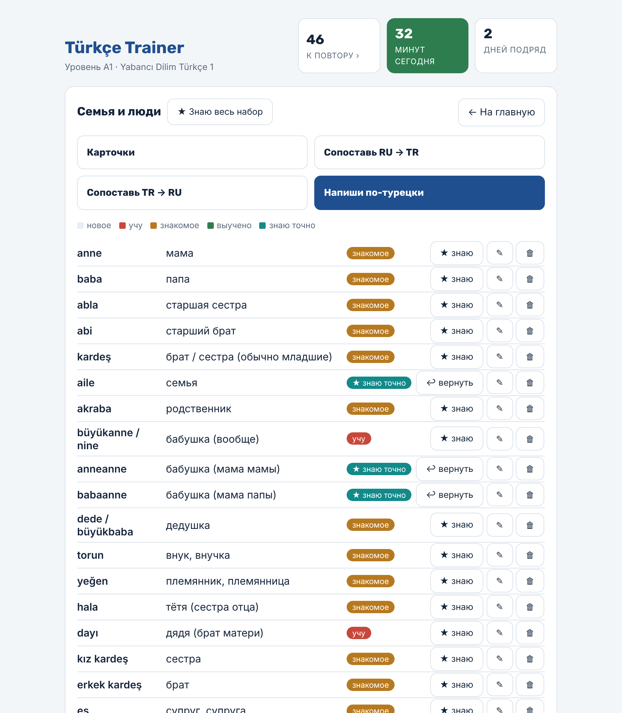
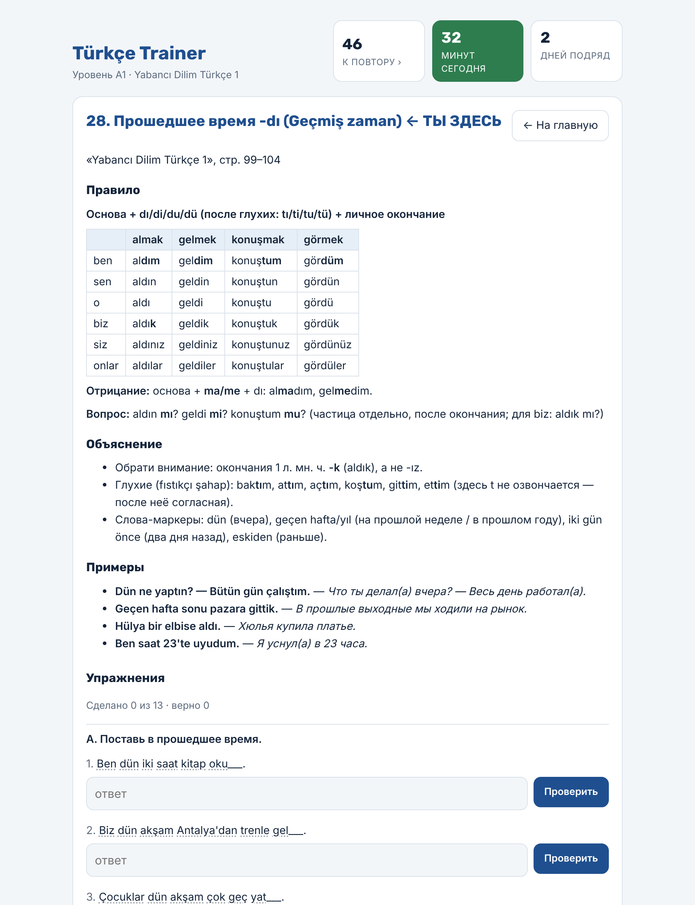
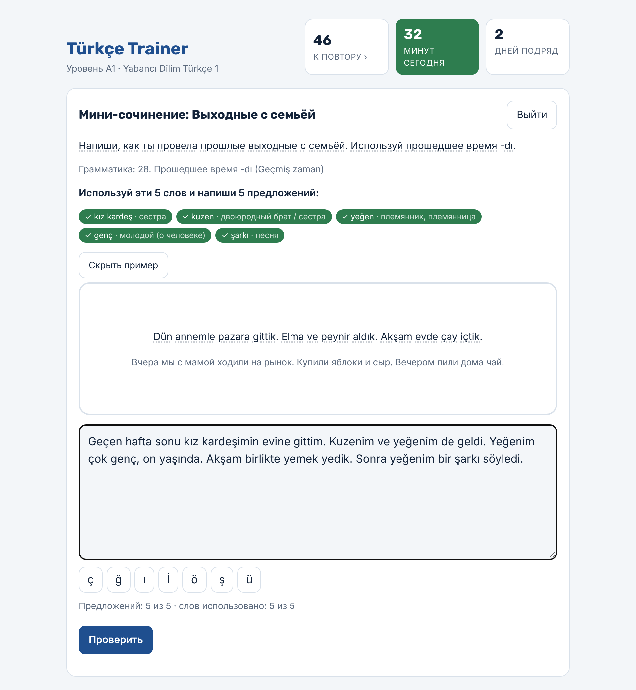

# Language trainer kit

A personal language teacher and trainer that runs in Claude. It works for any language and any level. Tell Claude your level and, if you like, give it a textbook or your own lesson notes. With nothing at all, it follows the official curriculum for your level. Claude then builds a trainer page for you: word sets and grammar rules, spaced repetition, writing that Claude checks, listening, reading, and a short lesson every day.

The screenshots are from a Russian speaker's trainer for Turkish (level A1, book "Yabancı Dilim Türkçe 1"). In your trainer, the buttons, instructions, translations and explanations are in your own language, and the words, rules and texts are in the language you learn.

## What it does

- **Builds the course from what you have.** Give Claude a textbook, your own lesson notes, both, or nothing. It turns them into word sets and grammar rules in the order you study. With no materials, it follows the official curriculum for your level.
- **Spaced repetition.** Every word and rule has its own level, from 0 to 7. Mistakes bring an item back sooner, and correct answers push it further away (1, 2, 4, 7, 14, 30 and 60 days).
- **A daily session.** The main page says what's due today: words to review, a few new words, and rules to review. It also tracks minutes per day and the days in a row you studied.
- **Material you've already covered counts.** Words and rules you've already studied start as "familiar", not "new". Upcoming rules (from your book or the curriculum) are listed with an "I want to learn this" button.
- **Progress syncs.** It is saved with the trainer, so your phone and computer show the same state.

## Exercises

| Exercise | What you do |
|---|---|
| Flashcards | See a word, recall it, flip the card. "Know" / "Don't know" / "Know for sure". |
| Matching (both ways) | Match words to translations, in rounds. |
| Write it | See a word in your language and type it in the language you learn. On-screen keys cover the special letters. Small typos and missing special letters count as "almost", and a hint shows one letter at a time. |
| Grammar test | Short tasks on the rules due today (fill in the ending, translate), checked at once. |
| Sentences | Translate a sentence or answer a question about yourself using a rule. Claude checks it and explains each mistake. |
| Mini-essay | Write a few sentences on a topic using given words (see below). |
| Listening | Claude writes a short dialogue or announcement at your level, and the trainer reads it aloud in the target language, one voice per speaker. Then you answer true/false and multiple-choice questions. Buttons show the text, the translation, and play it slower. |
| Reading | A text at your level with the same question types and a translation button. The text gets longer as your level and scores grow. |

Every exercise shows "question N of M" and your correct count. At the end you get a summary of what was right and wrong, with the reason for each mistake. When many mistakes are on one rule or word set, the summary links to it. In any text you can tap a word you don't know to see its translation, get a hint, or add it to your words.

## Word sets

Each word shows its status: new, learning, familiar, learned or known for sure. You can practise one set on its own, mark single words or the whole set as known, edit a translation, or delete a word.

The "+ New word set" button on the main page makes a set on any topic. Claude can generate the most useful words for that topic at your level (with "generate more"), or you type your own words and Claude checks the spelling and adds translations. Words you collect during exercises are sorted into fitting sets. When five or more of them share a topic, Claude offers a new set.

## Grammar rules

Each rule has an explanation, tables and examples with translations, plus exercises with instant checking and a test. You can mark a rule "know for sure" (the trainer asks first), and bring it back at any time. The main page can hide or show known rules and fully learned word sets.

When the checker sees a mistake on an older topic, it offers to put that rule back into review. If the topic isn't in your course yet, it offers to add it.

## Mini-essay

Claude picks a topic and words you're learning, plus a rule to practise. The number of sentences and words depends on your level and how your recent essays went. A model text is shown on some days. The word chips turn green as you use the words, and any correct form of a word counts. Claude then checks every sentence and gives you a corrected text, an explanation for each mistake, and a score. Each word used correctly counts as a review of that word.

## How to start

See [SETUP.md](SETUP.md). In short:

1. Add `SKILL.md` to Claude as a skill.
2. Create a project and add the `trainer-template` folder. If you have a textbook (PDF) or lesson notes, add them too; they're optional.
3. Say "Set up my language trainer". Claude asks for the language, your own language, your level, your book and page (if you use one), and how many minutes a day you want to study.

You need a Claude plan with Artifacts. Listening uses the trainer's built-in voice, which works in Chrome and the Claude desktop app but not in Safari, Firefox or the Claude mobile apps; there, the exercise shows the text instead.

## What's in this folder

- `SKILL.md`: the instructions Claude follows to build and run the trainer and the daily lessons.
- `SETUP.md`: the step-by-step setup guide.
- `trainer-template/`: the empty trainer page (`index.html`, with a settings block at the top) and empty data files.
- `screenshots/`: the images in this README.
